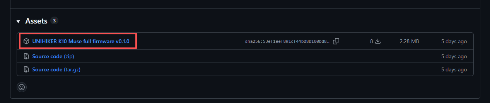
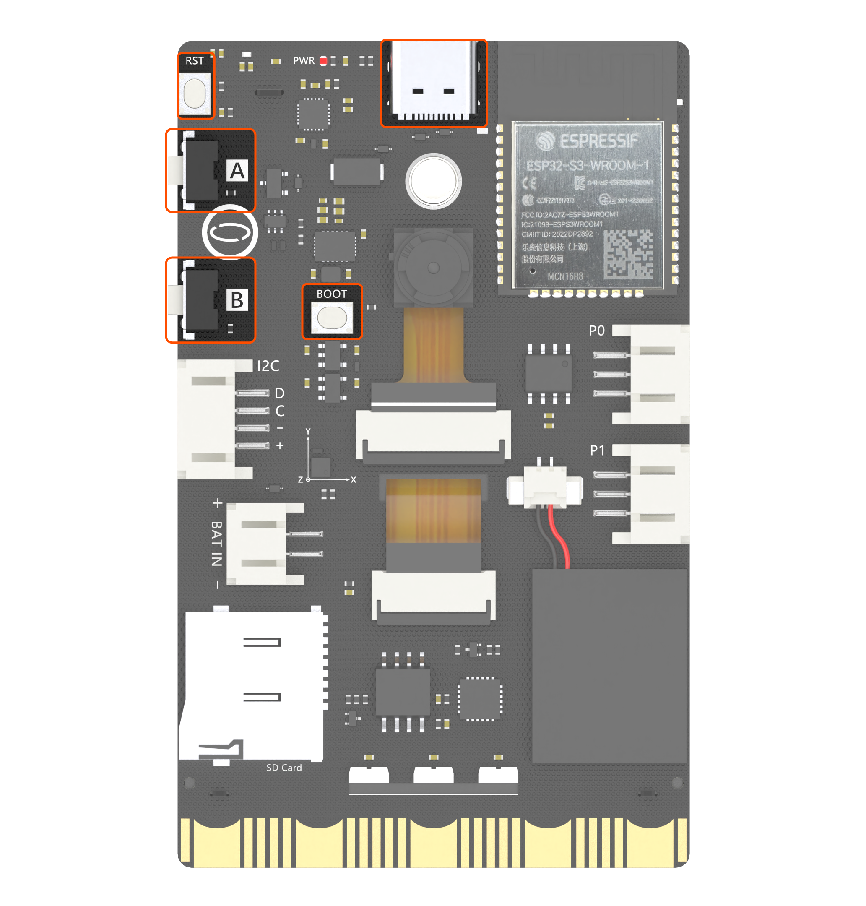
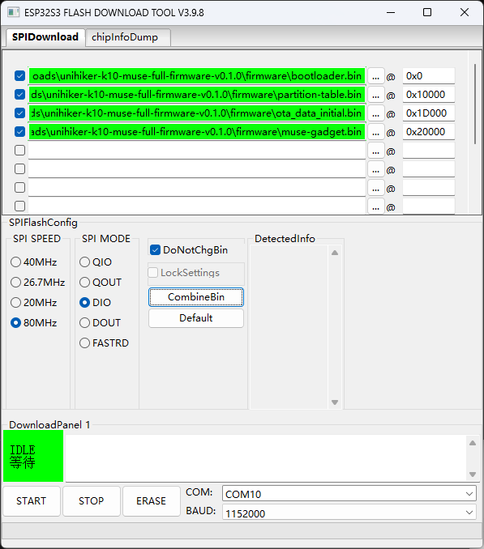
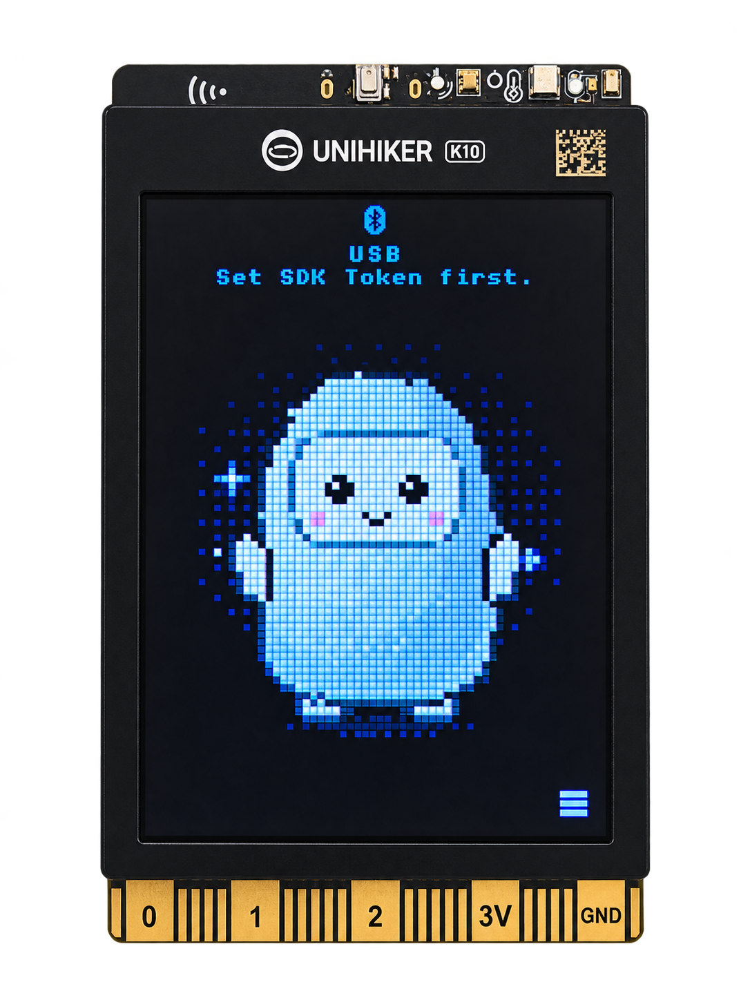
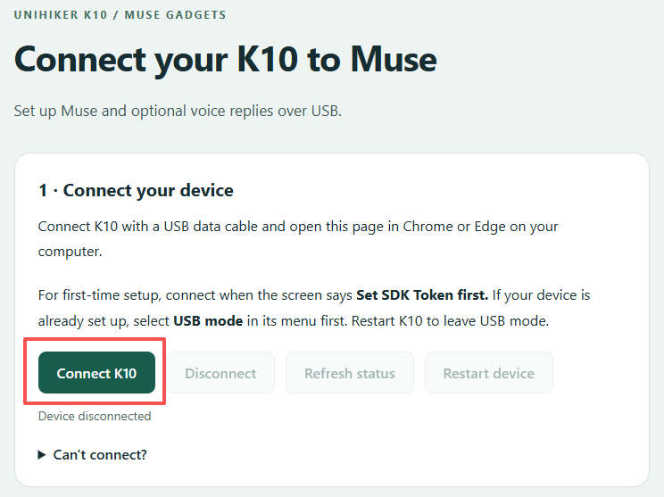
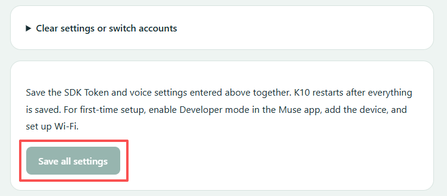
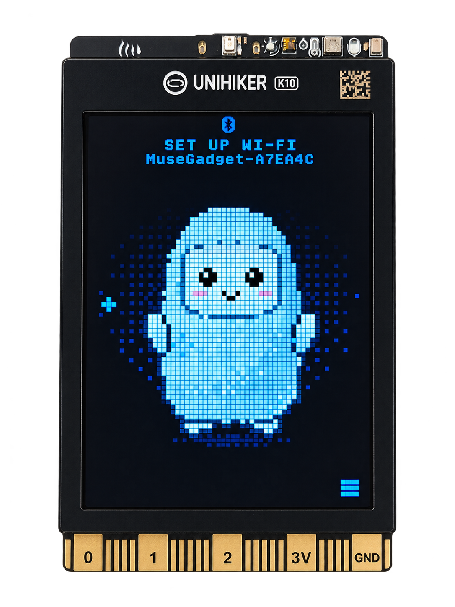
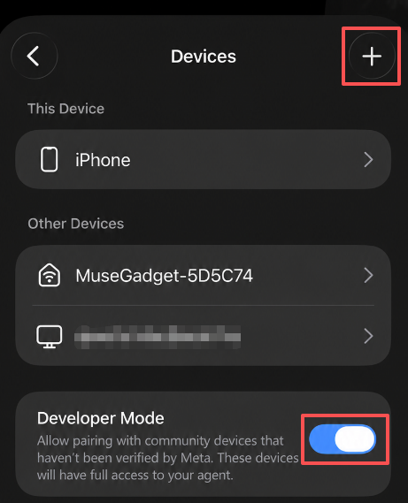
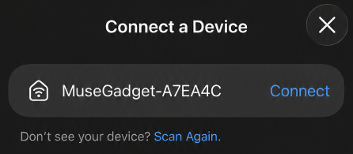
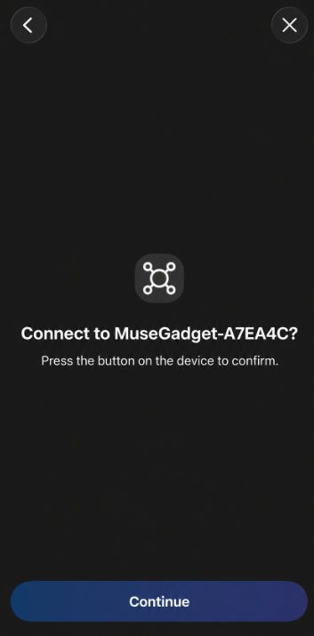

# Connect UNIHIKER K10 to Muse

Turn your UNIHIKER K10 into a Muse desktop companion that can talk with you, sense its surroundings, and look at objects.

Once setup is complete, hold the **A button** to speak, then release it to send your question to Muse. Replies appear on the screen. With the optional speech service configured, K10 can also read them aloud. You can ask Muse to read K10's temperature, humidity, light, and acceleration sensors, or use its camera to take a photo and identify an object.

This guide covers the **Muse K10 full firmware**. If it is already installed on your device, start with [Set up your SDK Token](#3-set-up-your-sdk-token).

## 1. Before you start

### What you need

| Item | Details |
|---|---|
| UNIHIKER K10 | The firmware in this guide is for K10 only |
| USB data cable | Included with K10; used for flashing, setup, and power |
| Computer | Windows, macOS, or Linux; use desktop Chrome or Edge for USB setup |
| Phone with the Muse app | You need a working Muse account and access to Developer mode |
| Wi-Fi | A 2.4 GHz network that can reach Muse services; a computer hotspot also works if set to 2.4 GHz |
| Muse Gadgets SDK Token | Required; obtain one through your own account |
| Cartesia API Key | Optional; needed only if you want K10 to read replies aloud |

Where to buy K10: [DFRobot store](https://www.dfrobot.com/product-2904.html) · [Global distributors](https://www.unihiker.com/distributors).

Before setting up K10, send a message in the Muse app on your phone and check that your account receives a reply.

### What you can do

| Feature | How to use it |
|---|---|
| Voice input | Hold A to speak, then release to send |
| On-screen replies | View the Muse avatar, connection status, and reply text |
| Spoken replies | Configure Cartesia to read Muse's text replies aloud |
| Temperature and humidity | Ask for K10's current temperature and humidity readings |
| Light readings | Ask for the ambient light level measured by K10 |
| Acceleration readings | Ask for K10's three-axis acceleration readings |
| Humidity reminders | K10 automatically sends Muse a message when humidity exceeds the threshold |
| Camera recognition | Point at an object and ask, "Use K10's camera and tell me what this is" |
| USB setup | Use one HTML file to configure credentials and speech, or clear settings |
| Device settings | Adjust volume, speaker, and sleep settings; view sensors and connection status |

## 2. Download and flash the firmware

### 2.1 Download the full firmware package

Open the [K10 full firmware release page](https://github.com/DFRobot/muse-gadget-sdk/releases/tag/k10-full-v0.1.0) and download this file under **Assets**:

**`unihiker-k10-muse-full-firmware-v0.1.0.zip`**

Extract the ZIP before continuing. It contains:

```text
firmware/
  bootloader.bin
  partition-table.bin
  ota_data_initial.bin
  muse-gadget.bin
usb-config/
  k10-usb-config.html
README.md
SHA256SUMS.txt
licenses/
```

The four BIN files in `firmware/` are used for flashing. Use `k10-usb-config.html` to configure your device afterward. The remaining files contain instructions, checksums, and licenses; you do not flash them to K10.

<p align="center">
  
</p>

### 2.2 Put K10 into download mode

1. Connect K10 to your computer with the USB data cable.
2. Hold **BOOT**.
3. While holding BOOT, press **RESET** once.
4. Release BOOT.

K10 is now in download mode and ready to flash. On Windows, check Device Manager for its serial port, such as `COM10`. Use the port shown on your own computer.

<p align="center">
  
</p>

### 2.3 Firmware files and flash addresses

The full firmware package contains four BIN files. Flash all four at their corresponding addresses:

| File | Address |
|---|---|
| `firmware/bootloader.bin` | `0x0` |
| `firmware/partition-table.bin` | `0x10000` |
| `firmware/ota_data_initial.bin` | `0x1D000` |
| `firmware/muse-gadget.bin` | `0x20000` |

**Make sure each file is assigned to the correct address.** Both flashing methods below use these same addresses.

### 2.4 Choose a flashing method

**Option 1: Windows graphical tool**

Use Espressif's [Flash Download Tools](https://www.espressif.com/en/support/download/other-tools). Select **ESP32-S3**, add the four files and addresses from the table above, and check all four rows.

Set **SPI MODE: DIO** and **SPI SPEED: 80 MHz**. Select K10's serial port, choose a baud rate such as `1152000`, and start flashing.

Do not flash `muse-gadget.bin` by itself at `0x0`. Before switching from the factory firmware to Muse, back up any programs or files you want to keep. A full flash erase deletes existing data and settings. Later updates to Muse firmware usually do not require a full erase.

<p align="center">
  
</p>

**Option 2: Command line on Windows, macOS, or Linux**

If Python is installed, open a terminal and install esptool:

```sh
python -m pip install esptool
```

List the available serial ports:

```sh
python -m serial.tools.list_ports
```

Open a terminal in the extracted firmware package folder. Run the following as one line, replacing `YOUR_PORT` with K10's actual serial port:

```sh
python -m esptool --chip esp32s3 --port YOUR_PORT --baud 460800 write-flash --flash-mode dio --flash-freq 80m --flash-size 16MB 0x0 firmware/bootloader.bin 0x10000 firmware/partition-table.bin 0x1d000 firmware/ota_data_initial.bin 0x20000 firmware/muse-gadget.bin
```

A Windows port might be `COM10`. On macOS, look for `/dev/cu.usbmodem…`; on Linux, it is often `/dev/ttyACM0`. If your system uses `python3`, replace `python` with `python3` in these commands.

### 2.5 Start K10 normally

After flashing, **press RESET once**.

On first startup, the screen displays the Muse avatar with `USB` and `Set SDK Token first.` at the top.

This means the firmware is running and waiting for you to configure your own SDK Token.

<p align="center">
  
</p>

## 3. Set up your SDK Token

### 3.1 Get your own SDK Token

Sign in to [Muse Gadgets](https://gadgets.muse.ai) with your Muse account. Go to **Account → SDK tokens**, create a token, and copy it.

The token starts with `mgst_`. It is separate from the optional Cartesia API Key described later. Enter each credential in its corresponding field. Do not use a token from a tutorial screenshot or someone else's account.

### 3.2 Open the USB setup tool

1. Keep K10 connected to your computer over USB.
2. Open `usb-config/k10-usb-config.html` from the downloaded package in desktop **Chrome or Edge**.
3. Click **Connect K10**.
4. Select K10 in the browser's serial port chooser and connect.

This is a standalone HTML file. You can usually open it directly without running a server. First close any flashing tool, serial monitor, or other setup page that is using K10's serial port.

If your browser blocks serial access from a local file, open a terminal in the `usb-config` folder and run:

```sh
python -m http.server 8766 --bind 127.0.0.1
```

Then open `http://localhost:8766/k10-usb-config.html` in Chrome or Edge. Keep the terminal running during setup; you can close it afterward.

<p align="center">
  
</p>

### 3.3 Save and restart

Paste your token into **2 · SDK Token**.

For your first setup, you can skip **3 · Voice replies (optional)** and start with text replies. To enable spoken replies, follow [Have K10 read replies aloud](#7-have-k10-read-replies-aloud-optional).

Click **Save all settings** at the bottom of the page. K10 automatically restarts after all the settings you entered have been saved successfully. It is normal for the page to disconnect during the restart.

Your token is saved on the device and remains stored after a restart or power loss. An empty token field afterward does not mean it was erased; reconnect to check the configuration status.

After a successful initial setup, K10 displays `SET UP WI-FI` and `MuseGadget-XXXXXX` at the top of the screen. The suffix varies by device.

<p align="center">
  
</p>

<p align="center">
  
</p>

## 4. Pair in the Muse app and connect to Wi-Fi

1. Enable Bluetooth on your phone and grant the Bluetooth or nearby-device permissions requested by Muse.
2. In the Muse app, go to **Settings → Devices** and enable **Developer mode**.
3. Select **Add Device** or the **+** button in the upper-right corner.

<p align="center">
  
</p>

4. Select `MuseGadget-XXXXXX` from the list. Match its suffix to the name at the top of K10's screen.

<p align="center">
  
</p>

5. When the app or K10 asks for confirmation, **press K10's A button once**.

<p align="center">
  
</p>

6. Follow the app's prompts to select a 2.4 GHz Wi-Fi network, enter its password, and wait for K10 to connect.

Once connected, K10's RGB LEDs are normally green and the screen shows `READY`. You can now start a conversation.

**If you previously cleared all settings on K10, remove the old K10 device from the Muse app before adding it again.** Clearing only the device's settings can leave an old record in the app and cause pairing to get stuck on connecting.

## 5. Start a voice conversation

1. **Hold K10's A button**.
2. Say, "Introduce yourself in one sentence."
3. **Release A** when you finish speaking to send the question.
4. Wait for Muse's reply and read it on the screen.

If spoken replies are configured, K10 reads the answer aloud once the audio is ready. During normal operation, pressing A while audio is playing interrupts playback and lets you start a new question.

You do not need to press B or open a menu first. Voice input uses push-to-talk; a wake word alone does not start recording.

After setup, you do not need to keep any companion program running on your computer. K10 can continue working as long as it has power, a network connection, and access to Muse services.

## 6. Use the sensors

### 6.1 Ask Muse directly

Hold A to ask a question, then release to send. Try:

> "Read K10's sensors and tell me the current temperature and humidity."
>
> "Use K10's light sensor to check how bright it is here."
>
> "Read K10's three-axis acceleration."

Muse requests sensor data from K10 as needed and uses the readings in its answer. Include "read K10's sensors" if you want to make clear that it should use actual measurements.

| Reading | What it means |
|---|---|
| Temperature | Measured in °C; heat from the board can affect the reading |
| Humidity | Measured in % RH, or relative humidity |
| Light | Measured in lux; useful for observing changes in ambient light |
| Acceleration | Raw X, Y, and Z readings, not calibrated values in g |

Invalid or expired readings are not supplied to Muse as valid measurements. If no readings are available, try again shortly.

### 6.2 View readings on K10

You can also view the local sensor page without asking Muse online:

1. Press **B** to open the menu.
2. Keep pressing **B** until **Sensors** is selected.
3. Press **A** to open the readings page.
4. Press **A or B** to return to the menu. Select **Close menu** to return to the main screen.

### 6.3 Automatic high-humidity reminders

K10 monitors humidity in the background using these rules:

| Humidity condition | Behavior |
|---|---|
| Above 70% RH | Send Muse a high-humidity message with the measured value |
| Still above 70% RH | Remind again 15 minutes after the last successfully delivered reminder |
| At or below 65% RH | Rearm the initial reminder, so the next rise above 70% can trigger it immediately |
| Above 65% and at or below 70% RH | Pause reminders without rearming the initial reminder |

You do not need to ask a question to trigger this feature, but K10 must be online and connected to Muse. It sends a message to Muse; **it does not automatically sound a local alarm on K10**. Phone notifications also depend on the Muse app and your phone's notification settings.

These rules are built into the firmware. The HTML tool currently cannot change the thresholds or reminder interval. Restarting K10 starts the rule again. Do not spray water on the board or cause condensation to test humidity. Covering the temperature and humidity sensor at K10's upper-right corner with a finger can quickly raise its reading.

This feature demonstrates how a device can proactively report events to an agent. With AI coding tools such as Muse Code or Codex, you can also adapt the source code to add more sensors or event rules.

## 7. Have K10 read replies aloud (optional)

### 7.1 Get a Cartesia API Key and Voice ID

K10 uses the online Cartesia service for speech synthesis. Without it, voice questions and on-screen text replies still work.

1. Sign in to [Cartesia](https://play.cartesia.ai/keys) and create your own key on the API Keys page.
2. Preview voices in Cartesia's voice library or Playground.
3. Choose a voice that supports your target language and copy its **Voice ID**.

The API Key authorizes access to the service; the Voice ID selects the voice. They are not interchangeable. The HTML tool includes this default Voice ID, which you can replace with your preferred voice:

```text
db6b0ed5-d5d3-463d-ae85-518a07d3c2b4
```

Check your Cartesia account for current credits, voice access, and pricing.

### 7.2 Save speech settings in the HTML tool

If you have already configured K10's SDK Token:

1. Press **B** on K10 to open the menu.
2. Use **B** to select **USB mode**, then press **A** to enter.
3. Wait until the screen shows **USB mode: On**.
4. Open the HTML tool on your computer and click **Connect K10**.

You do not need to enter **2 · SDK Token** again. Go directly to **3 · Voice replies (optional)** and fill in:

| Field | What to enter |
|---|---|
| Cartesia API Key | Your own Cartesia API Key |
| Voice ID | A voice that supports your target language; you can try the prefilled value first |
| Reply language | The language Muse actually uses in its replies |

**Reply language must match the language Muse uses, and the selected Voice ID must support that language. A mismatch can prevent voice playback.** For English replies, select **English** and use a voice that supports English.

Click **Save all settings** and wait for K10 to restart automatically. Then hold A to ask a question and check that the answer appears on the screen and is read aloud.

K10 receives and plays the audio as a stream directly from the online service. No computer-side TTS service is required. Muse generates the reply before Cartesia synthesizes it, so there can still be a delay before speech starts. Network fluctuations can also cause pauses.

Enabling this feature sends Muse's reply text to Cartesia and uses your service credits.

### 7.3 Test, change, or disable speech

- **Test speech:** After saving and restarting, make sure K10 is online and **Speaker** is enabled. Enter USB mode again, connect the HTML tool, and click **Test voice**. Testing uses Cartesia credits. Click **Refresh status** to check the result. The built-in test sentence is in English; if you configure Chinese, also test an actual Chinese conversation.
- **Change the voice or language:** Enter your Cartesia API Key again, change the Voice ID or Reply language, and click **Save all settings**.
- **Disable speech:** Click **Disable voice replies**, then **Restart device** to apply the change. Text replies remain available.

## 8. Identify objects with the camera

1. Point **K10's camera** at the object.
2. Hold **A** and ask, "Can you look at this and tell me what it is?"
3. Release A to send your question and keep the camera pointed at the object.
4. Wait for Muse to request a photo, receive the image, and answer.

The process is:

**You ask a question → Muse requests an image when needed → K10 takes and uploads a photo → Muse analyzes it and replies.**

Voice questions do not automatically include a photo. If the answer does not use a current image, explicitly ask, "Use K10's camera to take a new photo." Muse decides whether to request a capture.

The current firmware captures single **640 × 480** images. It does not provide a live viewfinder or continuous video. Keep K10 and the object still, and use even indoor lighting. Avoid pointing directly at bright windows or strong light sources: the current version can produce overexposed or color-shifted images in these conditions, affecting recognition.

## 9. Buttons, menu, and RGB status LEDs

### Button reference

| Situation | Action |
|---|---|
| Ask a question from the main screen | Hold A to record, then release to send |
| Confirm pairing | Press A once |
| Open the menu or move to the next item | Press B |
| Activate a menu item | Press A |
| Return to the main screen | Select Close menu, then press A |
| Leave USB mode | Save settings to restart automatically, press RESET, or click Restart device |
| Enter download mode for flashing | Hold BOOT, press RESET once, then release BOOT |

Common menu items:

| Item | Purpose |
|---|---|
| Volume | Adjust volume; press A to cycle through the levels |
| Sensors | View temperature, humidity, light, and acceleration |
| USB mode | Enter USB setup |
| Speaker | Turn the speaker on or off |
| Mic gain | Adjust microphone gain |
| Auto-sleep | Change the automatic screen-off delay |
| Wi-Fi | Turn Wi-Fi on or off |
| Status | View connection status and other information |
| Reset pairing | Clear Wi-Fi and app pairing, then restart; SDK Token and TTS settings are kept |
| Screen off | Turn off the screen; press a button to wake it |
| Power off | Enter a low-power off state; press RESET to start again |
| Close menu | Return to the main screen |

The **Brightness** setting does not provide continuous brightness adjustment in the current K10 firmware. The **Battery** page also does not provide a valid battery level.

### RGB LED reference

| LED pattern | Usually means |
|---|---|
| Breathing amber | Waiting for setup or offline |
| Breathing blue | Pairing or connecting |
| Green | Ready for a conversation |
| Blue | Recording |
| Breathing purple | Waiting for processing or capturing a photo |
| Breathing red | An error occurred |

Use the LEDs together with the screen messages and Muse app status to understand what is happening.

## 10. Change settings or switch accounts

### Reopen USB setup

Once an SDK Token has been saved, K10 starts in normal operating mode. To change settings, enter **USB mode** from K10's menu before connecting the HTML tool.

Entering USB mode **does not automatically restart K10**. The screen stays on the USB page, and the buttons are temporarily unavailable for other actions. Network and speech services may continue in the background. Clicking **Disconnect** in the page does not leave USB mode; restart K10 to exit.

### HTML tool buttons

| Button | Purpose |
|---|---|
| Connect K10 | Select a serial port and connect to K10 |
| Disconnect | Release the serial port used by the page |
| Refresh status | Read the current configuration and speech status again; does not save your entries or restart K10 |
| Restart device | Restart K10 to apply pending changes or leave USB mode |
| Save all settings | Save the SDK Token and speech settings you entered, then restart automatically once all saves succeed |

Leaving the SDK Token or API Key field blank keeps the corresponding settings already saved on K10. It does not delete them. If TTS is already configured, changing the voice or language still requires entering the API Key again.

### Clear settings

Expand **Clear settings or switch accounts** in the HTML tool:

| Option | Result |
|---|---|
| Clear SDK Token only | Clear only the SDK Token, effective after a restart; keep Wi-Fi, pairing, and speech settings |
| Clear all user settings | Clear the SDK Token, Wi-Fi, Muse pairing, and Cartesia settings, then request a restart |

Before switching Muse accounts or giving K10 to someone else, choose **Clear all user settings** and remove the old device from the original Muse app. Then configure and pair it using the new user's own token.

Clearing a token from K10 does not revoke it on the website. Simply reflashing Muse firmware does not automatically clear existing settings either.

## 11. Troubleshooting

### The HTML tool cannot connect to K10

Use desktop Chrome or Edge and the USB cable included with K10. If using another cable, make sure it supports data transfer. Select the correct serial port and close other serial tools or connected setup pages.

If an SDK Token is already configured, enter **USB mode** first. If you just flashed the firmware, release BOOT and press RESET once to leave download mode before connecting the HTML tool.

### The page disconnects after saving

K10 automatically restarts after successfully saving all settings, so a disconnect is expected. With a token configured, enter USB mode again after the restart to reconnect the setup page.

### The Muse app stays on connecting or K10 cannot join Wi-Fi

Check Developer mode, your phone's Bluetooth permissions, pairing confirmation with K10's A button, and the 2.4 GHz Wi-Fi network name and password. If you cleared K10's settings, remove the old device from the app before adding it again. Keep computer hotspots enabled and prevent the computer from sleeping and turning the hotspot off.

### The Muse app says it disconnected Muse to protect your information

Follow the app's instructions to submit a recovery ticket through the official support entry point. Make sure Muse can chat normally on your phone before troubleshooting K10. Reflashing K10 cannot fix a Muse account service or account-linking issue.

### Replies appear on the screen, but there is no sound

This is expected if Cartesia is not configured. If it is configured, check that:

- **Speaker** is enabled and **Volume** is above 0.
- The API Key is valid, and the Cartesia account has available credits and access to the selected voice.
- **Reply language** matches Muse's reply language, and the Voice ID supports it.
- Settings have been saved and K10 has restarted, and K10 can reach Cartesia services.

Try a short reply first. Text replies remain available if speech fails.

### Can I disable speech by deleting the text in the API Key field?

No. Leaving the field blank preserves saved settings. Click **Disable voice replies**, then restart K10.

### Camera recognition is inaccurate, or no photo is taken

Explicitly ask Muse to use K10's camera to take a photo. Keep the camera pointed at the object and avoid obstructions, movement, and strong backlighting. If no photo is requested, Muse may answer using only the text. If the image is overexposed or color-shifted, try again under even indoor lighting.

### Humidity is above 70%, but reminders are not sent continuously

K10 must be online and connected to Muse. While humidity remains high, it does not send a message for every sensor sample: reminders are spaced 15 minutes after the last successful delivery, and are sent only while humidity is above 70%. Humidity must drop to 65% or below to rearm a new initial reminder.

### Do I need to set up K10 again after a power loss?

Normally, no. The SDK Token, Wi-Fi, Muse pairing, and Cartesia configuration are retained. The humidity reminder timing starts again after a restart.

### Does K10 need to stay connected to a computer?

No. The computer is needed only for flashing and USB setup. Afterward, close the HTML tool, power K10 from a suitable USB supply, and keep it connected to the network. Speech does not require a computer-side proxy either.

### Can I still use K10's original offline AI or TF card features?

This Muse firmware provides the functions described above. It does not include the factory firmware's offline AI or TF card features. To use those features, follow K10's instructions to restore the factory firmware, and back up any data you want to keep first.

## 12. Links

- [K10 Muse full firmware download](https://github.com/DFRobot/muse-gadget-sdk/releases/tag/k10-full-v0.1.0)
- [K10 Muse full firmware source](https://github.com/DFRobot/muse-gadget-sdk/tree/muse-unihiker-k10-full)
- [Muse Gadgets SDK Token management](https://gadgets.muse.ai/settings/sdk-tokens)
- [Cartesia API Key management](https://play.cartesia.ai/keys)
- [K10 Muse Wiki](https://www.unihiker.com/wiki/K10/Playground/muse_unihiker_k10/)
- [K10 product page](https://www.dfrobot.com/product-2904.html)
- [Global distributors](https://www.unihiker.com/distributors)
